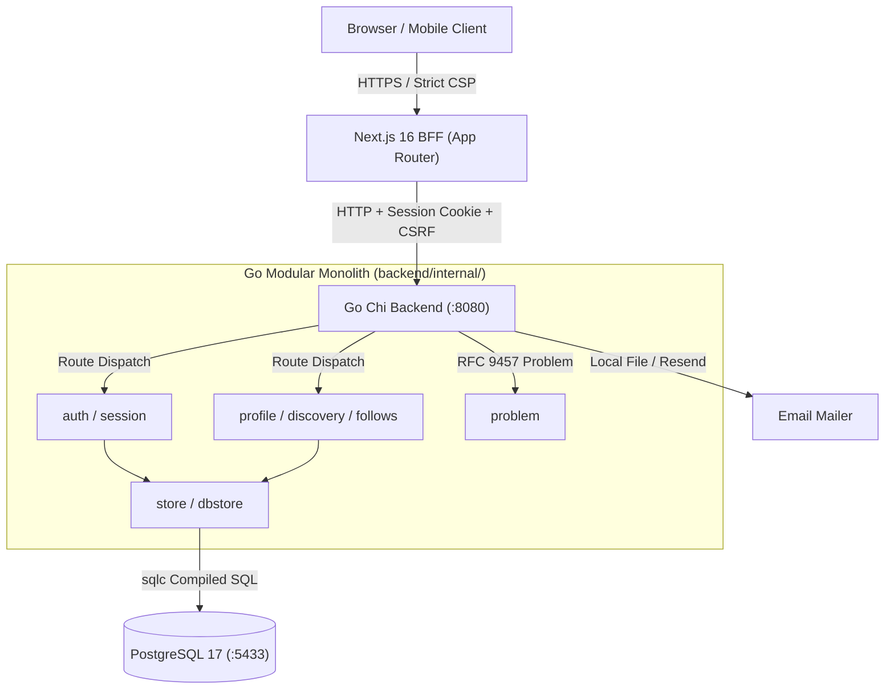
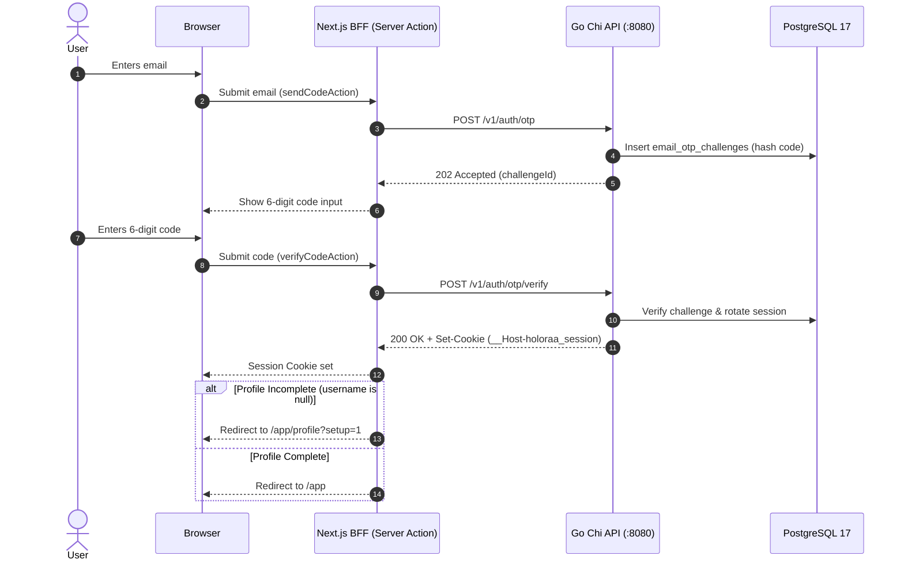
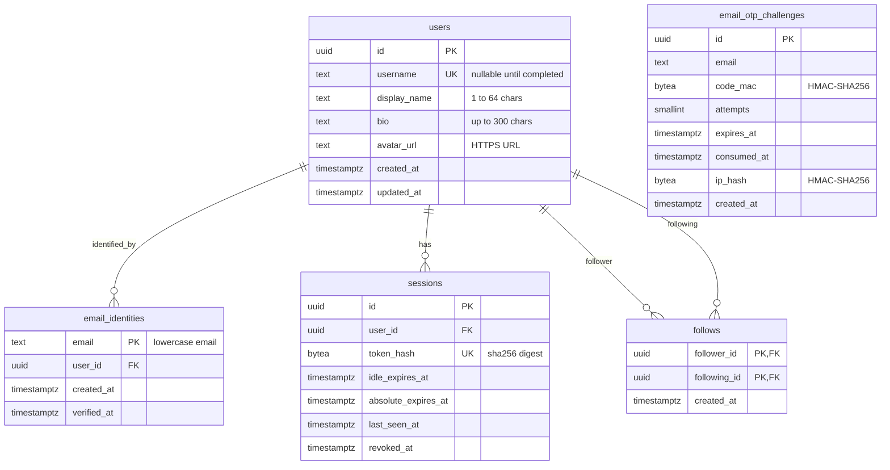

# Holoraa

> One simple, safe place to talk, share, and hang out with the people who matter.

[](https://go.dev/)
[](https://nextjs.org/)
[](https://www.postgresql.org/)
[](contracts/openapi.yaml)
[](docs/adr/0007-go-modular-monolith-foundation-v2.md)

Holoraa (spelled with two a's at the end) is a minimal, private communication platform built from first principles. It delivers fast, familiar messaging, spontaneous thoughts sharing, and personal rooms—without ads, tracking pixels, or algorithmic feed manipulation designed to harvest human attention.

---

## Table of Contents

- [What is Holoraa?](#what-is-holoraa)
- [Project Vision & Values](#project-vision--values)
- [Implementation Status](#implementation-status)
- [Core Features](#core-features)
- [Architecture Overview](#architecture-overview)
- [Technology Stack](#technology-stack)
- [Repository Layout](#repository-layout)
- [Authentication Architecture](#authentication-architecture)
- [User Profiles & Discovery](#user-profiles--discovery)
- [Social Graph Follow System](#social-graph-follow-system)
- [Database Design](#database-design)
- [API Architecture & Contracts](#api-architecture--contracts)
- [Frontend / Backend Communication](#frontend--backend-communication)
- [Local Development Setup](#local-development-setup)
- [Running Tests & Quality Gates](#running-tests--quality-gates)
- [Security & Privacy Principles](#security--privacy-principles)
- [Deployment Architecture](#deployment-architecture)
- [Known Limitations](#known-limitations)
- [Future Roadmap](#future-roadmap)
- [Contributing & Governance](#contributing--governance)

---

## What is Holoraa?

Modern social platforms force an artificial trade-off between chaotic enterprise productivity tools and attention-extracting algorithmic feeds. Holoraa offers a quiet third path—a calm, dark-first space for genuine connection with people who matter.

- **Calm by default:** Pitch-black OLED surfaces (`#000000`), clear typographic hierarchy, and zero clutter.
- **Private by design:** No tracking telemetry, no behavioral profiling, and strict session isolation.
- **Chronological & honest:** No algorithmic sorting, vanity metrics, streaks, or artificial engagement hooks.

---

## Project Vision & Values

- **Simple by default:** Interfaces prioritize readability, intuitive shortcuts (`⌘K`), and effortless navigation.
- **Safe by design:** Explicit permissions, fail-closed access control, and origin verification on every route and socket.
- **Respectful of attention:** Pure chronological feeds, natural resting points, and absence of infinite-scroll dopamine loops.
- **Non-Goals:**
  - 🚫 No advertisements.
  - 🚫 No harvesting or selling user data.
  - 🚫 No algorithmic feed ranking or manipulation.
  - 🚫 No public follower counts, streaks, or gamification mechanics.

---

## Implementation Status

Holoraa follows a strict, gated milestone roadmap. Work is divided into approved, completed layers and planned future workloads:

| Capability | Milestone | Status | Description |
|---|---|---|---|
| **Workspace Foundation** | M1 | **Completed** (`fbfe8f6`) | 4-column OLED workspace frame, navigation rails, and responsive layout. |
| **Authentication Engine** | M2 | **Completed** (`84a9528`) | Passwordless OTP email authentication, HttpOnly session cookie, and CSRF protection. |
| **Profiles & Discovery** | M3 | **Completed** (Active) | Onboarding gate, username claiming, pg_trgm user search, and directional follow graph. |
| **Real-Time Messaging & Sockets** | M4 | **Planned** | Contract-driven direct messaging, conversation threads, and Go WebSocket integration (`github.com/coder/websocket`). |
| **Media & File Sharing** | M5 | **Planned** | Presigned object uploads, attachments, and image previews. |
| **Voice & Video Calling** | M6 | **Planned** | WebRTC personal audio lounges and room connections. |
| **Notifications & Polish** | M7 | **Planned** | Notification center, delivery preferences, and UX refinements. |
| **Launch Readiness** | M8 | **Planned** | End-to-end security audit, load testing, and general availability. |

---

## Core Features

### 1. Passwordless Authentication (M2)
- Six-digit email verification code with 10-minute expiry.
- Cryptographically secure challenge verification using keyed HMAC-SHA256 message authentication codes (`code_mac`), binding each code to its challenge ID to prevent code reuse.
- One-way SHA-256 session token hashing (`token_hash` in PostgreSQL); plaintext session tokens never reside in persistent storage.
- Single host-bound, secure session cookie:
  - `__Host-holoraa_session`: HttpOnly, SameSite=Lax, Secure session token in production (or `holoraa_session` when `HOLORAA_COOKIE_SECURE=false` in local development).
- Session rotation on verification, automatic idle and absolute expiration tracking, and constant-time double-submit CSRF token verification derived via `HMAC-SHA256(secret, "csrf", session_id)`.

### 2. User Profiles & Onboarding Gate (M3)
- Incomplete profiles (`username === null`) are strictly intercepted and routed to `/app/profile?setup=1`.
- Unique username validation (`^[a-z][a-z0-9_]{2,31}$`) with system-reserved word filtering.
- Public/private data boundary: public profile queries strictly isolate emails and session tokens.
- Display name (1–50 chars), bio (up to 160 chars), and HTTPS avatar URL validation.

### 3. Authenticated User Discovery (M3)
- Global search overlay accessible via `⌘K` or sidebar button.
- Debounced (250ms) input queries against `GET /v1/users?q={query}`.
- Query execution strategy:
  - Empirically verified `pg_trgm` GIN indexes (`gin_trgm_ops`) on `username` and `display_name` accelerate both short prefix searches (`ILIKE 'ab%'`) and longer queries without requiring separate B-tree operator classes.
  - Standard queries apply a 5-tier deterministic ranking algorithm.
- Rate-limited to 60 search requests per minute per session.

### 4. Directional Follow Social Graph (M3)
- Idempotent `POST` and `DELETE /v1/users/{username}/follow` endpoints.
- Self-follow rejection enforced in application logic and PostgreSQL check constraints.
- Optimistic UI updates in `UserProfileModal` with instant rollback on API error.
- Strict isolation: following is a directional relationship and does not create conversations or grant unrestricted messaging access.

---

## Architecture Overview

Holoraa is architected according to **ADR 0007** as a Go modular monolith backend paired with a Next.js App Router Backend-for-Frontend (BFF).



---

## Technology Stack

| Layer | Component | Version | Rationale |
|---|---|---|---|
| **Backend** | Go Modular Monolith | Go 1.27.3 | Single module, zero ORM overhead, sub-millisecond startup, explicit memory layout. |
| **HTTP Router** | Chi | v5 | Lightweight, idiomatic Go HTTP routing without magic globals. |
| **API Contract** | OpenAPI | 3.1.1 | Single source of truth in `contracts/openapi.yaml`. Verified via Redocly CLI. |
| **Database** | PostgreSQL | 17 | Provisonal local Docker container (`holoraa-v2-postgres` on port 5433). |
| **Database Access** | sqlc | v1.28.0 | Compile-time generated, committed, drift-checked type-safe Go SQL queries. |
| **Migrations** | goose | v3.24.1 | Forward-only SQL migrations embedded in the API binary. Zero schema drift. |
| **Frontend** | Next.js App Router | 16.4.3 | Turbopack, React 19, Server Actions BFF, zero client secret leakage. |
| **Web Language** | TypeScript | 5.9 | Strict type checking (`noImplicitAny`, strict null checks). |
| **Testing** | Go Test & Vitest | Latest | Go `-race` across real Postgres; Vitest with 15 suites and 132 tests. |

---

## Repository Layout

```text
.
├── backend/                        # Go modular monolith
│   ├── cmd/api/                    # Application CLI & server entry point
│   ├── db/
│   │   ├── migrations/             # goose forward-only SQL migrations
│   │   └── queries/                # sqlc SQL query definitions
│   ├── internal/                   # Private application packages
│   │   ├── app/                    # Routing, middleware assembly, shutdown
│   │   ├── auth/                   # Passwordless OTP & session hashing
│   │   ├── config/                 # Validated environment configuration
│   │   ├── health/                 # /v1/health & /v1/ready handlers
│   │   ├── httpapi/                # Chi router, handlers, and rate limiters
│   │   ├── mail/                   # Fake local & production Resend mailers
│   │   ├── problem/                # RFC 9457 Problem Details error models
│   │   ├── profile/                # Profiles, discovery search & follow service
│   │   ├── store/                  # Storage interfaces & sqlc dbstore package
│   │   ├── testdb/                 # Scratch database test fixtures
│   │   └── version/                # Link-time version metadata
│   └── go.mod
├── contracts/                      # API contract specifications (Source of Truth)
│   ├── openapi.yaml                # OpenAPI 3.1.1 HTTP specification
│   └── events/                     # Realtime JSON Schema event specs
├── docs/                           # Architectural, product & operational specs
│   ├── adr/                        # Architecture Decision Records (0000–0011)
│   ├── architecture/               # API, data model, and security specs
│   ├── milestones/                 # Milestone PRDs, HLDs, LLDs & Test Plans
│   └── MILESTONE_GATES.md          # Acceptance gates for M0 through M8
├── web/                            # Next.js 16 + TypeScript web application
│   ├── src/
│   │   ├── app/                    # App Router pages (/sign-in, /app, /app/profile)
│   │   ├── components/             # React 19 UI components & design system
│   │   │   ├── app/                # AppShell, ProfileMenu, ProfileForm
│   │   │   ├── landing/            # Landing page hero, principles, navbar
│   │   │   ├── ui/                 # Avatar, FollowButton, Brand, Skeletons
│   │   │   └── workspace/          # SearchOverlay, UserProfileModal, Rails
│   │   └── lib/                    # Auth flows, API client, CSP, motion
│   └── package.json
└── Makefile                        # Build, test, migration, and verification targets
```

---

## Authentication Architecture



---

## User Profiles & Discovery

### Search Engine Strategy
User discovery utilizes a deterministic five-tier ranking algorithm:
1. Exact username match (`lower(username) = lower(query)`).
2. Username prefix match (`username ILIKE query || '%'`).
3. Display name prefix match (`display_name ILIKE query || '%'`).
4. Trigram similarity score (`similarity(username, query)` descending).
5. Deterministic alphabetical tie-breaker (`username ASC, id ASC`).

Both short prefix queries (1–2 characters) and longer search queries (3+ characters) are accelerated by PostgreSQL `pg_trgm` GIN indexes with `gin_trgm_ops` across `users.username` and `users.display_name`, ensuring sub-millisecond index scans without requiring duplicate B-tree pattern operator classes.

---

## Social Graph Follow System

Follow edges are stored in the `follows` relational table:
- **Directional:** User A following User B creates a single record `(follower_id = A, following_id = B)`.
- **Self-Follow Protection:** Enforced via `CHECK (follower_id != following_id)` and application validation.
- **Idempotency:** Repeated follow requests use `ON CONFLICT (follower_id, following_id) DO NOTHING` and return `204 No Content`. Repeated unfollow requests delete existing rows and return `204 No Content`.
- **Decoupled:** Following does not grant messaging privileges or automatically create conversations.

---

## Database Design



---

## API Architecture & Contracts

All HTTP routes are declared in `contracts/openapi.yaml` (OpenAPI 3.1.1) as the single source of truth:

| Method | Endpoint | Auth | CSRF | Rate Limit | Description |
|---|---|:---:|:---:|:---:|---|
| `GET` | `/v1/health` | No | No | None | Liveness probe (process running). |
| `GET` | `/v1/ready` | No | No | None | Readiness probe (database connection active). |
| `POST` | `/v1/auth/otp` | No | No | IP (5/hr) | Request passwordless sign-in email challenge. |
| `POST` | `/v1/auth/otp/verify` | No | No | IP (10/hr) | Verify six-digit code and create session. |
| `POST` | `/v1/auth/logout` | Yes | Yes | None | Revoke session and clear cookies. |
| `GET` | `/v1/users/me` | Yes | No | None | Fetch own authenticated profile and completion state. |
| `PATCH` | `/v1/users/me` | Yes | Yes | None | Update own profile (username, displayName, bio, avatar). |
| `GET` | `/v1/users` | Yes | No | 60/min | Authenticated discovery search (`?q={query}&limit={10}`). |
| `GET` | `/v1/users/{username}` | Yes | No | None | Public profile retrieval (strict private field exclusion). |
| `POST` | `/v1/users/{username}/follow` | Yes | Yes | 30/min | Create directional follow edge. |
| `DELETE` | `/v1/users/{username}/follow` | Yes | Yes | 30/min | Remove directional follow edge. |

---

## Frontend / Backend Communication

1. **Server Actions BFF:** Client components never call backend endpoints directly. They invoke Next.js Server Actions (`searchUsersAction`, `followUserAction`, etc.).
2. **Session Cookie Forwarding:** The Next.js BFF transparently proxies the `__Host-holoraa_session` cookie (or `holoraa_session` in dev) to Go Chi and applies incoming `Set-Cookie` headers back to the browser response.
3. **Strict Content-Security-Policy (CSP):** Pure nonce-based CSP for all scripts. Inline styles (`style="..."`) are prohibited and validated by automated tests.
4. **RFC 9457 Error Normalization:** All Go API errors map to Problem Details. The BFF maps status codes into friendly user messages without exposing stack traces or database errors.

---

## Local Development Setup

### Prerequisites
- **Linux / macOS environment**
- **Docker & Docker Compose** (for PostgreSQL 17)
- **Go 1.27.3** (extracted to `~/toolchains/go1.27.3/go/bin/go`)
- **Node.js 20+ & npm** (for Next.js web client)
- **sqlc v1.28.0**

### 1. Initialize Development Environment
Generate secure local `.env` configuration:
```bash
scripts/dev-env.sh
```

### 2. Start PostgreSQL & Run Migrations
```bash
make db-up         # Launches Docker container holoraa-v2-postgres on port 5433
make migrate-up    # Executes goose migrations (00001, 00002, 00003)
make migrate-status
```

### 3. Run Backend API Server
```bash
set -a && . ./.env && set +a
cd backend && /home/ck/toolchains/go1.27.3/go/bin/go run ./cmd/api serve
# Backend listens on http://127.0.0.1:8080
```

### 4. Run Next.js Web Application
```bash
cd web
npm install
npm run dev
# Web application accessible at http://localhost:3000
```

---

## Running Tests & Quality Gates

Holoraa maintains zero tolerance for test regressions or schema drift.

### Backend Verification
```bash
# Vet analysis
cd backend && /home/ck/toolchains/go1.27.3/go/bin/go vet ./...

# Full race-detector suite against real PostgreSQL scratch databases
source .env && export HOLORAA_TEST_DATABASE_URL="$HOLORAA_DATABASE_URL"
cd backend && /home/ck/toolchains/go1.27.3/go/bin/go test -race -count=1 ./...
```

### API Contract Check
```bash
# Validates OpenAPI 3.1.1 contract and confirms zero TypeScript schema drift
make contract-check
```

### Frontend Verification
```bash
cd web
npm run typecheck    # Strict TypeScript checks (0 errors)
npm run lint         # ESLint checks (0 warnings, 0 errors)
npm test             # Vitest suite (15 test files, 132 tests passing)
npm run build        # Production Next.js Turbopack build
```

---

## Security & Privacy Principles

- **Zero Inline Styles:** Automated tests verify strict CSP nonce enforcement.
- **Parametric SQL Exclusively:** No raw string interpolation. Wildcard inputs (`%`, `_`, `\`) are escaped before parameter binding.
- **Fail-Closed Access Rules:** Unauthenticated requests to `/app` or `/v1/users` immediately reject with 401 Problem Details.
- **Safe Session Storage:** Session IDs are 256-bit cryptographically secure random values; only their SHA-256 digests (`token_hash`) are stored in PostgreSQL. Raw session tokens are never stored or logged.
- **Cryptographic MAC Verification:** OTP codes are never stored as plaintext or simple hashes; they are verified using keyed HMAC-SHA256 message authentication codes (`code_mac`) bound to the challenge identifier.
- **Private Data Redaction:** Logs use structured `log/slog` with automatic redaction of tokens, passwords, cookies, and request bodies. Email identities are strictly isolated from public user profiles.
- **Origin & CSRF Enforcement:** State-changing endpoints (`POST`, `PATCH`, `DELETE`) require explicit Origin validation against an allowlist and constant-time double-submit CSRF token checks.

---

## Deployment Architecture

- **Stateless Monolith:** Go Chi API server compiles to a single standalone binary (`bin/api`) with embedded migrations.
- **Zero In-Memory Session State:** Sessions and challenges reside in PostgreSQL, allowing horizontal scaling behind standard reverse proxies.
- **BFF Isolation:** Next.js client renders on Node/Edge runtime, keeping API credentials and backend service topology private.

---

## Known Limitations

- **Messaging in Development:** Real-time chat messages and direct conversations are deferred to Milestone 4. Active workspace messaging panels operate as non-functional visual design previews.
- **Process-Local Rate Limiting:** Search (60/min) and follow (30/min) rate limiters operate as in-memory sliding windows within the single Go process instance. They reset on server restart and do not coordinate across multiple backend replicas without distributed state (e.g. Redis).
- **WebSockets Deferred:** WebSocket connections for live notifications, presence, and real-time event streaming will be introduced in Milestone 4.
- **Local File Mailer:** In local development, verification emails write to `backend/.local/mail/`. Production Resend delivery activates via `HOLORAA_RESEND_API_KEY`.
- **Audio Lounges & Rooms:** WebRTC rooms and audio tiles are currently interactive design previews; live media will be integrated in Milestone 6.

---

## Future Roadmap

- [x] **M0: Repository Skeleton** — Go module, entry point, Makefile, git safety.
- [x] **M1: Workspace Foundation** — 4-column OLED workspace shell, navigation rails, and layout.
- [x] **M2: Authentication Foundation** — Passwordless OTP email authentication, session cookies, and CSRF protection.
- [x] **M3: User Profiles & Discovery** — Onboarding gate, user search with pg_trgm, and directional follow graph.
- [ ] **M4: Real-Time Messaging & Sockets** — Contract-driven direct messaging, conversation threads, message persistence, and Go WebSocket integration (`github.com/coder/websocket`).
- [ ] **M5: Media & File Sharing** — Presigned object storage uploads, attachments, and image previews.
- [ ] **M6: Voice & Video Calling** — WebRTC personal audio lounges, rooms, and screen sharing.
- [ ] **M7: Notifications & Polish** — Notification center, user delivery preferences, and UX refinements.
- [ ] **M8: Production Launch Readiness** — End-to-end security audit, load testing, and general availability.

---

## Contributing & Governance

All contributors and AI agents must strictly follow the rules in [`AGENTS.md`](AGENTS.md):
- Never work directly on `main`.
- Never rewrite git history or force-push.
- Stage explicit paths only; never use `git add .` or `git add -A`.
- Require explicit owner approval before any commit, tag, branch operation, or push.
- Keep tests and documentation synchronized with code changes.
