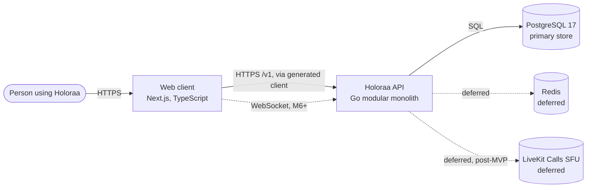

# System Architecture — Holoraa (v2)

- **Purpose:** Target architecture for Holoraa v2: components, boundaries, and failure behaviour.
- **Owner:** Lead Software Architect
- **Status:** Approved for Foundation & Phase 1/2 Architecture Alignment. Governed by [AGENTS.md](../../AGENTS.md) and [ADR 0007](../adr/0007-go-modular-monolith-foundation-v2.md).
- **Last Updated:** 2026-10-30
- **Implemented vs Proposed:** The foundation skeleton exists: backend health, readiness, configuration, structured logging, goose migrations, OpenAPI contract, and web status page. Slice 1 authentication and profiles backend is implemented on `feat/auth-profiles`. Realtime WebSockets, messaging, The Spot, spaces, and personal rooms are planned across milestones.

---

## 1. Context



---

## 2. Containers and Boundaries

- **Backend:** One Go module at `backend/`. Packages live under `backend/internal/`. Packages are created only when containing real code.
- **Web Client:** Next.js (App Router) and TypeScript in `web/`. Talks to the backend only through the published contracts in `contracts/`. It never directly accesses the database.
- **Contracts:** `contracts/` is the source of truth for both HTTP (OpenAPI 3.1.1) and Realtime events (JSON Schema). Generated code is committed and never edited by hand.
- **Database:** PostgreSQL 17. Schema changes are managed exclusively through forward-only goose migrations in `backend/db/migrations/`. Queries are compiled by `sqlc`.

Planned and implemented backend packages:

| Package | Milestone | Status | Responsibility |
|---|---|---|---|
| `internal/version` | M0 | Implemented | Build version reported by the binary |
| `internal/config` | M1 | Implemented | Configuration from environment variables only |
| `internal/logging` | M1 | Implemented | Structured logs with redaction |
| `internal/problem` | M2 | Implemented | RFC 9457 Problem Details |
| `internal/health` | M2 | Implemented | Liveness and readiness handlers |
| `internal/store` | M2 | Implemented | PostgreSQL connection pool and goose migration runner |
| `internal/httpapi` | M2 | Implemented | Chi router, middleware, and HTTP routes |
| `internal/app` | M2 | Implemented | Server startup, lifecycle, and graceful shutdown |
| `internal/auth` | M9 (Slice 1) | Implemented | Email OTP challenges, session tokens, and CSRF protection |
| `internal/profiles` | M9 (Slice 1) | Implemented | Own profile and public profile retrieval/updates |
| `internal/realtime` | M6 | Planned | WebSocket gateway, origin check, ping/pong, and event routing |
| `internal/thoughts` | Phase 1/2 | Planned | The Spot thoughts stream, mood indexing, and like tracking |
| `internal/social` | Phase 1/2 | Planned | Directed follows, 2-hop mutual recommendations, and user notes |
| `internal/rooms` | Phase 3 | Planned | Personal room slug reservations, lock states, and knock approvals |

---

## 3. Search and Social Graph Architecture

Holoraa implements a layered search and discovery architecture designed for sub-millisecond perceived latency without compromising data privacy:

```mermaid
flowchart TD
  subgraph Client [Browser Memory]
    UserInput[User Search Input] --> Trie[In-Memory Prefix Trie]
    UserInput --> Trigram[Trigram Fuzzy Matcher]
    Trie --> LocalRank[Calm Gravity + 2-Hop Ranker]
    Trigram --> LocalRank
    LocalRank --> FastUI[Instant Suggestions & Orbit Cards]
  end

  subgraph Server [Holoraa Go Backend & PostgreSQL]
    FastUI -.->|Async Deep Search / Fallback| APIEndpoint[/v1/search & /v1/thoughts]
    APIEndpoint --> FTS[PostgreSQL 17 tsvector GIN Index]
    APIEndpoint --> DBTrgm[pg_trgm GIN Index on profiles]
    APIEndpoint --> AuthFilter{Authorization Filter}
    AuthFilter --> AuthorizedResults[Authorized Matches]
  end
```

### A. Client-Side Prefix Trie & Trigram Matcher
- **Prefix Trie:** Indexes usernames, first/last names, and common vibe tokens (`film`, `coffee`, `synth`, `building`) in browser memory for instant typeahead (< 1ms).
- **Trigram Similarity:** A client-side Jaccard trigram fuzzy matcher computes similarity scores to tolerate minor typos.
- **2-Hop BFS Graph Traversal:** Evaluates mutual friends (`A follows B`, `B follows C`, `A does not follow C` → `C` is in `A`'s 2-hop orbit).
- **Security Boundary:** Client-side search is **never authoritative for private data**. It operates exclusively over data the authenticated user is already permitted to see (cached public profiles and active following/followers).

### B. Server-Side Authoritative Search
- **Full-Text Search:** `thoughts.search_vector` is a native stored `tsvector` generated column indexed with GIN.
- **Profile Fuzzy Search:** Enabled via the PostgreSQL `pg_trgm` extension with GIN trigram indexes on `users.username` and `users.display_name`.
- **Authorization Enforcement:** All server queries enforce privacy boundaries (blocked users are excluded, private messages are never indexed in global search).

---

## 4. Feature Lifecycles & Bridges

### A. The Spot to Direct Message Bridge ("Reply in DM")
To prevent public reply threads from escalating into attention-seeking performative arguments, Holoraa bridges thoughts directly into 1-on-1 private conversations:
1. User clicks **"Reply in DM"** on a thought authored by User B.
2. Web client opens or focuses the 1-on-1 direct conversation with User B.
3. The composer populates an active quoted reference pointing to `thought.id`.
4. When sent, `messages.quoted_thought_id` records the foreign key relationship.
5. If the original thought is deleted, `quoted_thought_id` is set to `NULL` (`ON DELETE SET NULL`), and the message gracefully shows *"Quoted thought was deleted"*.

### B. Personal Rooms & Knock Lifecycle
Personal rooms provide persistent, quiet audio/video hangouts with waiting room gatekeeping:
1. **Knock Request:** A visitor opens `holoraa.app/r/:slug` while the room is locked or has waiting room enabled. The client issues a `room.knock` realtime event.
2. **Host Notification:** The room host receives the knock event containing the visitor's public profile and an ephemeral knock identifier.
3. **Host Decision:** The host taps `[Let in]` or `[Decline]`.
4. **Approval & Access Token:** On approval, the backend emits `room.approved` containing a short-lived cryptographically signed token. The guest client presents this token to join the media stage.
5. **Security Enforcement:** Knock approval is strictly enforced server-side; a guest cannot bypass the waiting room or connect to media streams without a valid token.

---

## 5. Failure Behaviour

| Failure | Expected Behaviour |
|---|---|
| PostgreSQL unreachable | `/v1/ready` returns 503. Health stays 200. Write endpoints return 503 as RFC 9457 Problem Details. |
| Realtime connection drops (M6+) | Client reconnects with exponential backoff and retrieves missed messages via cursor query `GET /v1/conversations/{id}/messages?after={last_seen_id}`. |
| API unreachable | Web app shows an explicit offline/unreachable banner. Stale data is never represented as live state. |

---

## 6. Deferred Components

| Component | Why Deferred | Criteria to Activate |
|---|---|---|
| **Redis** (pub/sub, presence) | Single-instance modular monolith is sufficient for foundation and MVP | Multi-instance horizontal scaling requirement approved in an ADR |
| **FastAPI** (AI/moderation) | No ML workload required for foundation | Heavy automated moderation or content embedding workload |
| **LiveKit SFU** | Core chat, thoughts, and spaces take priority | Completion of M6 realtime gateway and owner approval of SFU hosting |
| **Object Storage** (Cloudflare R2) | Phase 3 attachment handling | Implementation of media uploads |
