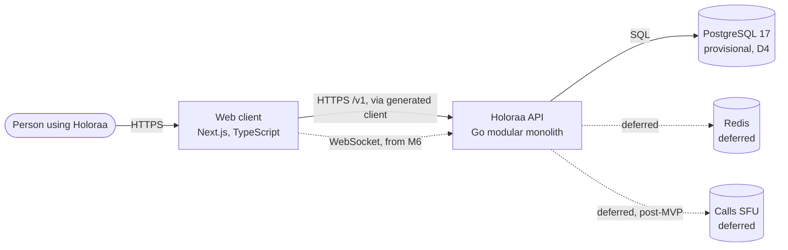

# System Architecture — Holoraa (v2)

- **Purpose:** Target architecture for Holoraa v2: components, boundaries, and failure behaviour.
- **Owner:** TODO(owner): Lead Software Architect
- **Status:** Draft for owner review. Governed by [AGENTS.md](../../AGENTS.md) and [ADR 0007](../adr/0007-go-modular-monolith-foundation-v2.md) (Proposed).
- **Last Updated:** 2026-10-25
- **Implemented vs Proposed:** The foundation skeleton exists: backend health and readiness, configuration, logging, migrations, the OpenAPI contract, and the status page. Sections 5 and 6 and the feature packages are planned. Tooling versions are in [ADR 0008](../adr/0008-foundation-skeleton-tooling.md).

---

## 1. Context

Solid lines are planned for the foundation. Dotted lines are deferred and need a separate decision before they are built.

## 2. Containers and boundaries

- **Backend:** one Go module at `backend/`. Packages live under `backend/internal/`. A package is created only when it contains real code.
- **Web client:** Next.js (App Router) and TypeScript in `web/`, from milestone M5. It talks to the backend only through the published contracts in `contracts/`. It never reads the database.
- **Contracts:** `contracts/` is the source of truth. HTTP uses OpenAPI 3.1.1. Realtime events use JSON Schema. Generated code is committed and never edited by hand.
- **Database:** PostgreSQL. Schema changes go through goose migrations in `backend/db/migrations/`. Queries are SQL in `backend/db/queries/`, compiled by sqlc.

Planned backend packages (each created at the milestone that needs it):

| Package | Milestone | Status | Responsibility |
|---|---|---|---|
| `internal/version` | M0 | Implemented | Build version reported by the binary |
| `internal/config` | M1 | Implemented | Configuration from environment variables only |
| `internal/logging` | M1 | Implemented | Structured logs with redaction |
| `internal/problem` | M2 | Implemented | RFC 9457 Problem Details |
| `internal/health` | M2 | Implemented | Liveness and readiness handlers |
| `internal/store` | M2 | Implemented | PostgreSQL pool and goose migrations. sqlc output comes at M3. |
| `internal/httpapi` | M2 | Implemented | Router and request middleware |
| `internal/app` | M2 | Implemented | Server startup and graceful shutdown |
| `internal/realtime` | M6 | Planned | WebSocket endpoint, origin check, ping/pong |

Feature packages (messaging, communities, calls) are not planned here. They wait for the approvals listed in section 6.

## 3. First runtime behaviour (planned)

1. `GET /v1/health` returns 200 when the process is running. It has no database dependency.
2. `GET /v1/ready` returns 200 when PostgreSQL answers, and 503 otherwise. Both return RFC 9457 Problem Details on error, with no internal detail.
3. The web status page calls `/v1/health` and `/v1/ready` through the generated client and shows the result.

## 4. Failure behaviour (planned)

| Failure | Expected behaviour |
|---|---|
| PostgreSQL unreachable | `/v1/ready` returns 503. Health stays 200. Write endpoints (when they exist) return 503 as Problem Details. |
| Realtime connection drops (M6+) | Client reconnects with backoff. Resume and catch-up rules are defined in [REALTIME.md](REALTIME.md) when realtime features are approved. |
| Web cannot reach the API | The status page shows an explicit error state. It does not show stale data as current. |

## 5. Deferred components

| Component | Why deferred | What is needed to start it |
|---|---|---|
| Redis (pub/sub, presence) | No feature needs it yet (AGENTS.md) | A feature that needs cross-instance fan-out, plus an approved design |
| FastAPI (AI, moderation, analytics) | No real workload yet (AGENTS.md) | A real workload and its own ADR |
| LiveKit or another SFU (calls) | Post-MVP (AGENTS.md; PRD) | Owner decision on the calling approach. See the legacy [ADR 0005](../adr/0005-livekit-webrtc-media-engine.md) |
| Object storage (attachments, avatars) | Phase 3 | Owner decision on the provider |
| Transactional email (magic links, notices) | Depends on the auth design | Owner decision on the auth method |

## 6. Blocked until owner approval

- **Authentication and authorisation.** Not implemented until the owner approves a design. Protected routes and sockets fail closed.
- **Direct messages and any messaging feature.** Depends on authentication.
- **Calls, feed, and stories.** Out of scope until approved (AGENTS.md).

## 7. Scaling path (not planned for the foundation)

The foundation runs as one backend instance with one PostgreSQL database. Horizontal scaling (multiple instances, a shared pub/sub layer, read replicas) is a later decision. It should be written as an ADR when real load justifies it, not before.

## 8. Related documents

- [TECH_STACK.md](TECH_STACK.md): stack decisions and their status
- [DATA_MODEL.md](DATA_MODEL.md): draft entity model
- [API.md](API.md): HTTP conventions
- [REALTIME.md](REALTIME.md): realtime contract (planned)
- [../MILESTONE_GATES.md](../MILESTONE_GATES.md): milestone gates and open decisions
