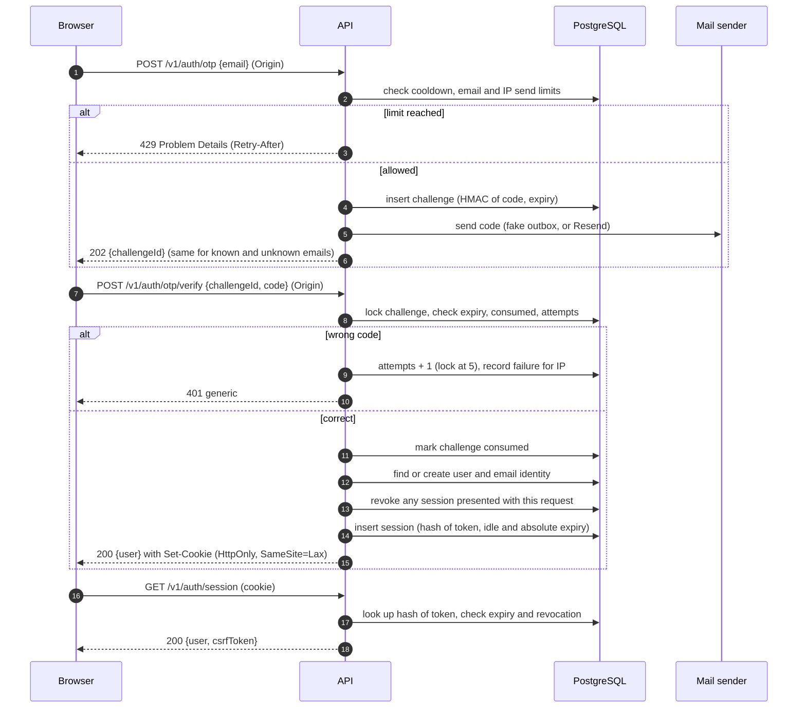
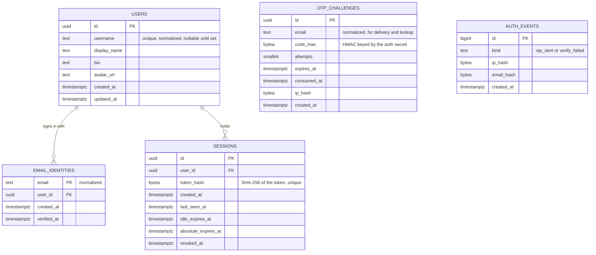

# Authentication and profiles: low-level design

- **Status:** Slice 1 (email one-time codes, sessions, profiles, backend) is implemented on `feat/auth-profiles` and not yet merged. Frontend flows (slice 2) and Google sign-in (slice 3) are planned.
- **Decision:** [ADR 0009](../adr/0009-authentication-and-sessions.md) (Proposed). This document is the implementation detail. Where they disagree, ADR 0009 governs and this document must be fixed.
- **Contract:** `contracts/openapi.yaml` is the source of truth for the endpoints below.

---

## 1. Scope

| In slice 1 (implemented) | Planned |
|---|---|
| Email one-time code sign-in (fake sender for development, Resend adapter activated by configuration) | Frontend sign-in and profile screens (slice 2) |
| Server-side sessions, rotation, logout | Google sign-in with OIDC (slice 3) |
| Profile read and update, public profile read | Avatar upload, account deletion, data export |
| Origin and CSRF checks on state-changing requests | Trusted-proxy settings for production |

## 2. Endpoints

All paths are under `/v1`. Every error is RFC 9457 Problem Details.

| Method and path | Auth | Purpose | Success | Notable errors |
|---|---|---|---|---|
| `POST /auth/otp` | none, Origin required | Send a code to an email address | 202 with `challengeId` | 400 invalid email; 429 cooldown, email or IP limit |
| `POST /auth/otp/verify` | none, Origin required | Check a code and sign in | 200 with `user`, sets the session cookie | 401 invalid, expired, consumed, or locked (one generic message); 429 IP limit |
| `GET /auth/session` | session cookie | Current user and CSRF token | 200 with `user`, `csrfToken` | 401 no valid session |
| `POST /auth/logout` | session, Origin, CSRF | Revoke the session and clear the cookie | 204 | 401; 403 CSRF or Origin |
| `GET /me` | session | Own profile, including email | 200 | 401 |
| `PATCH /me` | session, Origin, CSRF | Update own profile | 200 | 400 validation; 409 username taken; 401; 403 |
| `GET /users/{username}` | session | Public profile (no email) | 200 | 401; 404 unknown username |

`user` in auth responses is the `Me` shape. `username` is `null` until profile setup. `profileComplete` is `true` once a username is set.

## 3. Sequence: sign-in with a code

## 4. Core domain ER diagram

Slice 1 tables. Google identities (slice 3) will add a table keyed by provider subject, not by email.

## 5. Validation rules

- **Email:** trimmed and lowercased. At most 254 characters. Exactly one `@`, a non-empty local part without spaces, and a domain containing a dot. This is a shape check only; deliverability is not checked.
- **Code:** exactly six ASCII digits.
- **Username:** 3 to 32 characters, lowercase letters, digits, and underscores, starting with a letter. Case is folded to lowercase, and no other character is changed silently. Reserved names are rejected: `admin`, `api`, `holoraa`, `me`, `root`, `support`, `users`, `v1`.
- **Display name:** 1 to 64 characters after trimming. No control characters.
- **Bio:** 0 to 300 characters. No control characters.
- **Avatar URL:** `https` only, at most 2048 characters, no userinfo. Upload is a later slice.
- **Bodies:** at most 4 KiB. Unknown JSON fields are rejected on writes. Trailing data is rejected.

## 6. Limits (defaults)

| Limit | Default | Scope | Status |
|---|---|---|---|
| Resend cooldown | 60 seconds | per email | Owner approved |
| Codes sent | 5 per rolling hour | per email | Owner approved |
| Wrong attempts | 5, then the challenge is locked | per challenge | Owner approved |
| Codes sent | 20 per rolling hour | per client address (the connection's address; forwarded headers are never read) | Owner approved (D11) |
| Failed verifications | 30 per rolling 15 minutes | per client address (same scope) | Owner approved (D11) |
| Code lifetime | 10 minutes | per challenge | Owner approved |
| Session idle expiry | 14 days, sliding | per session | Owner approved |
| Session absolute expiry | 30 days | per session | Owner approved |

Limits are counted from PostgreSQL, so they hold across API processes. Redis is not needed.

## 7. Errors

| Situation | Status | Detail |
|---|---|---|
| Malformed email, code, or JSON | 400 | "The request is not valid." The same generic message for every malformed input, so the response does not describe the rule that failed. |
| Wrong, expired, consumed, or locked code | 401 | "The code is invalid or has expired." (identical for every case) |
| No valid session | 401 | "Sign in to continue." |
| Missing or foreign Origin, or CSRF token mismatch | 403 | "The request origin is not allowed." or "The CSRF token is missing or invalid." |
| Rate limit | 429 | "Too many requests. Try again later." with `Retry-After` |
| Username taken | 409 | "That username is already taken." |
| Unknown profile | 404 | "No profile has this username." |

## 8. Configuration

| Setting | Required | Notes |
|---|---|---|
| `HOLORAA_AUTH_SECRET` | yes | At least 32 characters. HMAC key for codes and CSRF tokens. Generated by `make dev-env`. Never logged. |
| `HOLORAA_ALLOWED_ORIGINS` | yes | Comma-separated origins, for example `http://127.0.0.1:3000`. |
| `HOLORAA_ENV` | no, default `production` | `production` or `development`. Production fails closed: it requires an explicit mail provider, refuses `fake`, and refuses insecure cookies. Only development may use the local setup. |
| `HOLORAA_COOKIE_SECURE` | no, default `true` | Must stay `true` in production. `false` is accepted only in development. |
| `HOLORAA_MAIL_PROVIDER` | required in production; default `fake` in development | `resend` in production. `fake` (development only) or `resend` in development. |
| `HOLORAA_MAIL_OUTBOX_DIR` | no, default `.local/mail` | Fake provider only. Files are created with mode 0600 and the directory is git-ignored. |
| `HOLORAA_MAIL_FROM` | when `resend` | Sender address. Needs a verified domain at the provider (owner action). |
| `HOLORAA_RESEND_API_KEY` | when `resend` | Secret. Never printed or logged. |

Development never needs a real key. With the fake provider, the code is written to a local file under `.local/mail/`, which is the only place the code appears in development.

## 9. Test plan

Database-backed tests run under `make test-db`. Without the database they skip, and the skip is reported.

- **Codes:** generation is six digits; expiry; single use; replay after success; lockout at five attempts; cooldown; hourly limit per email; hourly limit per IP; failure limit per IP; the same response for known and unknown emails; the stored value is not the code.
- **Sessions:** creation; the raw token is absent from the database; idle and absolute expiry (times set in the test); revocation on logout; rotation on sign-in; the cookie attributes.
- **CSRF and Origin:** missing or foreign Origin is rejected; a session request without the CSRF token is rejected; the token is bound to the session.
- **Profiles:** validation table; username uniqueness and normalization; a session can change only its own profile; no email in public profiles.
- **Migrations:** up, down, and up again from an empty database.
- **Contract:** each new response is checked against the OpenAPI schema by the conformance test.
- **Logs:** the access and error logs contain no codes, tokens, or emails.

## 10. Known limitations of slice 1

- No frontend. Use the API directly or the fake outbox.
- No real email is sent in development, so the Resend adapter is checked against an HTTP stub, not the live service, until the owner configures a domain and key.
- Retention is implemented as a purge inside the send transaction, with the periods in section 11. The periods are proposed, and the owner has not approved them (D11).
- Trusted-proxy handling is not implemented, and forwarded headers are never read. Behind a reverse proxy, every client shares the proxy's address, so the per-address limits apply to all users together. This must be resolved before a production deployment behind a proxy (D11).

## 11. Retention (proposed, not yet approved)

| Data | Kept for | Why this period | Status |
|---|---|---|---|
| Unused or expired sign-in challenges | 24 hours after expiry | Long enough to diagnose a delivery or sign-in complaint; the code is useless after expiry. | Proposed. Owner input needed (D11). |
| Send and failure events | 48 hours | The longest rate window is one hour, so 48 hours is a safe margin. Events hold only hashes. | Proposed. Owner input needed (D11). |
| Expired sessions | 30 days after absolute expiry | Gives support a window to answer account questions. Revoked and expired sessions grant no access. | Proposed. Owner input needed (D11). |

Retention is applied by a purge that runs inside the code-sending transaction. A dedicated scheduled job can replace it later. Deleting an account is not implemented yet, and it will need its own retention design.
