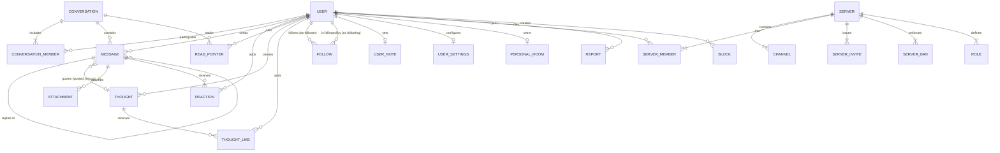

# Data Model — Holoraa (v2 draft)

- **Purpose:** Entity model for Holoraa. Guides schema migrations, indexing, and foreign key semantics.
- **Owner:** Database & Backend Lead
- **Status:** Approved for Foundation & Phase 1/2 Architecture Alignment.
- **Last Updated:** 2026-10-30
- **Implemented vs Proposed:** Slice 1 authentication & profile entities (`users`, `email_identities`, `email_otp_challenges`, `sessions`, `auth_events`) are implemented in `backend/db/migrations/00002_auth_profiles.sql`. The remaining entities are scheduled for goose migrations at their respective milestones.

---

## 1. General Schema Rules

- **Migration Tool:** Goose is the only migration tool (`backend/db/migrations/`). Never edit database schemas by hand.
- **Forward-Only SQL:** Migrations are forward-only, code-reviewed, and tested from an empty database in CI.
- **Query Compilation:** Queries are written in SQL under `backend/db/queries/` and compiled by `sqlc` into committed type-safe Go code.
- **PostgreSQL Version:** PostgreSQL 17 (provisional, alpine image in Docker Compose).
- **Identifier Strategy:** UUIDs for all primary keys.
  - Standard entities: `gen_random_uuid()` (v4).
  - Time-ordered stream entities (`thoughts`, `messages`): Application-generated UUIDv7 (via `github.com/google/uuid` in Go) to guarantee monotonic chronological cursor ordering without distributed clock skew, typed natively as PostgreSQL `uuid`.
- **Timestamps:** Always `timestamptz` with `DEFAULT now()`.
- **Text & Size Limits:** Every user input has strict length constraints (`CHECK` constraints) enforced at the boundary and in SQL.

---

## 2. Entity Relationship Diagram



---

## 3. Entity Definitions

### A. Profiles, Settings, and Identity (Slice 1 Implemented + Refinements)

```sql
-- Extensions required
CREATE EXTENSION IF NOT EXISTS pg_trgm;

-- Users (Implemented in 00002_auth_profiles.sql)
-- Trigram indexes added for fast fuzzy typeahead on usernames and display names:
CREATE INDEX IF NOT EXISTS idx_users_username_trgm ON users USING gin (username gin_trgm_ops);
CREATE INDEX IF NOT EXISTS idx_users_display_name_trgm ON users USING gin (display_name gin_trgm_ops);

-- User Settings (Approved refinement)
CREATE TABLE user_settings (
    user_id                 uuid PRIMARY KEY REFERENCES users (id) ON DELETE CASCADE,
    read_receipts_enabled   boolean NOT NULL DEFAULT true,
    active_status_enabled   boolean NOT NULL DEFAULT true,
    quiet_hours_enabled     boolean NOT NULL DEFAULT false,
    quiet_hours_start       time,
    quiet_hours_end         time,
    updated_at              timestamptz NOT NULL DEFAULT now()
);

-- Ephemeral 24hr Status Note (The Spot / Notes Tray)
CREATE TABLE user_notes (
    user_id     uuid PRIMARY KEY REFERENCES users (id) ON DELETE CASCADE,
    text        varchar(60) NOT NULL,
    expires_at  timestamptz NOT NULL,
    updated_at  timestamptz NOT NULL DEFAULT now()
);
CREATE INDEX idx_user_notes_expires ON user_notes (expires_at);
```

### B. The Spot: Thoughts, Likes, and Social Graph

```sql
-- Social Graph: Directed follow edges
CREATE TABLE follows (
    follower_id     uuid NOT NULL REFERENCES users (id) ON DELETE CASCADE,
    following_id    uuid NOT NULL REFERENCES users (id) ON DELETE CASCADE,
    created_at      timestamptz NOT NULL DEFAULT now(),
    PRIMARY KEY (follower_id, following_id),
    CHECK (follower_id <> following_id)
);
CREATE INDEX idx_follows_following ON follows (following_id);

-- Thoughts: Chronological stream with full-text search
-- id is UUIDv7 generated application-side for natural chronological indexing
CREATE TABLE thoughts (
    id              uuid PRIMARY KEY,
    author_id       uuid NOT NULL REFERENCES users (id) ON DELETE CASCADE,
    text            varchar(280) NOT NULL,
    mood            varchar(32),
    photo_key       text CHECK (photo_key IS NULL OR char_length(photo_key) <= 2048),
    created_at      timestamptz NOT NULL DEFAULT now(),
    -- Native PostgreSQL 17 generated stored tsvector column; stays strictly synchronized with text
    search_vector   tsvector GENERATED ALWAYS AS (to_tsvector('english', coalesce(text, ''))) STORED
);

CREATE INDEX idx_thoughts_created_id ON thoughts (created_at DESC, id DESC);
CREATE INDEX idx_thoughts_author_created ON thoughts (author_id, created_at DESC);
CREATE INDEX idx_thoughts_search_vector ON thoughts USING gin (search_vector);

-- Thought Likes
CREATE TABLE thought_likes (
    thought_id      uuid NOT NULL REFERENCES thoughts (id) ON DELETE CASCADE,
    user_id         uuid NOT NULL REFERENCES users (id) ON DELETE CASCADE,
    created_at      timestamptz NOT NULL DEFAULT now(),
    PRIMARY KEY (thought_id, user_id)
);
CREATE INDEX idx_thought_likes_user ON thought_likes (user_id);
```

### C. Direct Messages and Group Chat

```sql
CREATE TABLE conversations (
    id              uuid PRIMARY KEY DEFAULT gen_random_uuid(),
    kind            text NOT NULL CHECK (kind IN ('dm', 'group', 'channel')),
    created_by      uuid REFERENCES users (id) ON DELETE SET NULL,
    created_at      timestamptz NOT NULL DEFAULT now()
);

CREATE TABLE conversation_members (
    conversation_id uuid NOT NULL REFERENCES conversations (id) ON DELETE CASCADE,
    user_id         uuid NOT NULL REFERENCES users (id) ON DELETE CASCADE,
    joined_at       timestamptz NOT NULL DEFAULT now(),
    PRIMARY KEY (conversation_id, user_id)
);

-- Messages table references thoughts via quoted_thought_id
-- Thoughts must be created before messages in migration ordering
CREATE TABLE messages (
    id                  uuid PRIMARY KEY, -- Application-generated UUIDv7
    conversation_id     uuid NOT NULL REFERENCES conversations (id) ON DELETE CASCADE,
    sender_id           uuid NOT NULL REFERENCES users (id) ON DELETE CASCADE,
    body                text NOT NULL CHECK (char_length(body) BETWEEN 1 AND 4000),
    reply_to_id         uuid REFERENCES messages (id) ON DELETE SET NULL,
    quoted_thought_id   uuid REFERENCES thoughts (id) ON DELETE SET NULL,
    client_msg_id       uuid, -- Idempotency key from client
    created_at          timestamptz NOT NULL DEFAULT now(),
    edited_at           timestamptz
);

CREATE INDEX idx_messages_conversation_created ON messages (conversation_id, created_at DESC, id DESC);
CREATE UNIQUE INDEX idx_messages_idempotency ON messages (conversation_id, sender_id, client_msg_id) WHERE client_msg_id IS NOT NULL;

-- Quoted Thought Deletion Semantics:
-- When a thought is deleted, quoted_thought_id in referencing messages is automatically set to NULL (ON DELETE SET NULL).
-- The web client renders a calm tombstone ("Quoted thought was deleted"), preventing message history corruption.

CREATE TABLE attachments (
    id          uuid PRIMARY KEY DEFAULT gen_random_uuid(),
    message_id  uuid NOT NULL REFERENCES messages (id) ON DELETE CASCADE,
    kind        text NOT NULL CHECK (kind IN ('image', 'audio', 'video', 'document')),
    object_key  text NOT NULL,
    size_bytes  bigint NOT NULL CHECK (size_bytes > 0),
    mime_type   text NOT NULL,
    created_at  timestamptz NOT NULL DEFAULT now()
);

CREATE TABLE reactions (
    message_id  uuid NOT NULL REFERENCES messages (id) ON DELETE CASCADE,
    user_id     uuid NOT NULL REFERENCES users (id) ON DELETE CASCADE,
    emoji       varchar(16) NOT NULL,
    created_at  timestamptz NOT NULL DEFAULT now(),
    PRIMARY KEY (message_id, user_id, emoji)
);

CREATE TABLE read_pointers (
    conversation_id         uuid NOT NULL REFERENCES conversations (id) ON DELETE CASCADE,
    user_id                 uuid NOT NULL REFERENCES users (id) ON DELETE CASCADE,
    last_read_message_id    uuid NOT NULL REFERENCES messages (id) ON DELETE CASCADE,
    updated_at              timestamptz NOT NULL DEFAULT now(),
    PRIMARY KEY (conversation_id, user_id)
);
```

### D. Communities: Spaces, Channels, Invites, and Bans

```sql
CREATE TABLE servers (
    id          uuid PRIMARY KEY DEFAULT gen_random_uuid(),
    name        varchar(64) NOT NULL CHECK (char_length(name) >= 1),
    description text CHECK (description IS NULL OR char_length(description) <= 300),
    owner_id    uuid NOT NULL REFERENCES users (id) ON DELETE RESTRICT,
    created_at  timestamptz NOT NULL DEFAULT now()
);

CREATE TABLE channels (
    id          uuid PRIMARY KEY DEFAULT gen_random_uuid(),
    server_id   uuid NOT NULL REFERENCES servers (id) ON DELETE CASCADE,
    name        varchar(32) NOT NULL CHECK (name ~ '^[a-z0-9_-]{1,32}$'),
    kind        text NOT NULL CHECK (kind IN ('text', 'voice')),
    position    smallint NOT NULL DEFAULT 0,
    created_at  timestamptz NOT NULL DEFAULT now()
);

CREATE TABLE server_members (
    server_id   uuid NOT NULL REFERENCES servers (id) ON DELETE CASCADE,
    user_id     uuid NOT NULL REFERENCES users (id) ON DELETE CASCADE,
    role        text NOT NULL DEFAULT 'member' CHECK (role IN ('owner', 'admin', 'moderator', 'member')),
    joined_at   timestamptz NOT NULL DEFAULT now(),
    PRIMARY KEY (server_id, user_id)
);

-- Server Invites
CREATE TABLE server_invites (
    code        text PRIMARY KEY CHECK (char_length(code) BETWEEN 6 AND 32),
    server_id   uuid NOT NULL REFERENCES servers (id) ON DELETE CASCADE,
    creator_id  uuid NOT NULL REFERENCES users (id) ON DELETE CASCADE,
    max_uses    int CHECK (max_uses IS NULL OR max_uses > 0),
    uses_count  int NOT NULL DEFAULT 0 CHECK (uses_count >= 0),
    expires_at  timestamptz,
    revoked_at  timestamptz,
    created_at  timestamptz NOT NULL DEFAULT now()
);
CREATE INDEX idx_server_invites_server ON server_invites (server_id);

-- Server Bans
CREATE TABLE server_bans (
    server_id   uuid NOT NULL REFERENCES servers (id) ON DELETE CASCADE,
    user_id     uuid NOT NULL REFERENCES users (id) ON DELETE CASCADE,
    reason      text CHECK (reason IS NULL OR char_length(reason) <= 500),
    banned_by   uuid REFERENCES users (id) ON DELETE SET NULL,
    created_at  timestamptz NOT NULL DEFAULT now(),
    PRIMARY KEY (server_id, user_id)
);

-- Security and Concurrency Rules for Invites:
-- 1. Code Generation: 16-byte cryptographically secure random alphanumeric string generated server-side.
-- 2. Atomic Consumption:
--    UPDATE server_invites
--    SET uses_count = uses_count + 1
--    WHERE code = $1
--      AND (max_uses IS NULL OR uses_count < max_uses)
--      AND (expires_at IS NULL OR expires_at > now())
--      AND revoked_at IS NULL
--    RETURNING server_id;
-- 3. Ban Check: Prior to admitting the joining user, verify:
--    SELECT 1 FROM server_bans WHERE server_id = $server_id AND user_id = $joining_user_id;
--    If a ban record exists, the join request fails with 403 Forbidden.
-- 4. Revocation: Admins and server owners can revoke invites by setting revoked_at = now().
```

### E. Personal Rooms and Calls

```sql
CREATE TABLE personal_rooms (
    user_id                 uuid PRIMARY KEY REFERENCES users (id) ON DELETE CASCADE,
    slug                    text UNIQUE NOT NULL CHECK (slug ~ '^[a-z][a-z0-9_]{2,31}$'),
    is_locked               boolean NOT NULL DEFAULT false,
    waiting_room_enabled    boolean NOT NULL DEFAULT true,
    updated_at              timestamptz NOT NULL DEFAULT now()
);

-- Semantics:
-- - Exactly 1 personal room per user account.
-- - Slugs default to the user's initial approved username.
-- - Transfer of room slugs between users is disallowed to prevent handle squatting.
-- - When a user deletes their account, the personal room is removed with CASCADE.
```

### F. Trust, Safety, and Privacy

```sql
CREATE TABLE blocks (
    blocker_id  uuid NOT NULL REFERENCES users (id) ON DELETE CASCADE,
    blocked_id  uuid NOT NULL REFERENCES users (id) ON DELETE CASCADE,
    created_at  timestamptz NOT NULL DEFAULT now(),
    PRIMARY KEY (blocker_id, blocked_id),
    CHECK (blocker_id <> blocked_id)
);

CREATE TABLE reports (
    id              uuid PRIMARY KEY DEFAULT gen_random_uuid(),
    reporter_id     uuid NOT NULL REFERENCES users (id) ON DELETE CASCADE,
    reported_id     uuid NOT NULL REFERENCES users (id) ON DELETE CASCADE,
    reason          text NOT NULL CHECK (char_length(reason) BETWEEN 3 AND 500),
    status          text NOT NULL DEFAULT 'pending' CHECK (status IN ('pending', 'reviewed', 'resolved', 'dismissed')),
    snapshot        jsonb NOT NULL,
    created_at      timestamptz NOT NULL DEFAULT now()
);

-- Moderation Snapshot (reports.snapshot) Governance:
-- - Immutable JSONB captured strictly at the instant of report filing.
-- - Scope: Contains up to 10 immediately surrounding messages in the conversation (message IDs, sender IDs, bodies, timestamps).
-- - Privacy Minimization: Strips auth tokens, cookies, IP addresses, email addresses, and unrelated conversation channels.
-- - Access: Restricted to authenticated administrators/moderators.
-- - Retention: Retained for 90 days after report resolution (per PRIVACY_AND_COMPLIANCE.md), then hard deleted.
```

---

## 4. Indexing Strategy Summary

1. `users`: GIN trigram indexes on `username` and `display_name` via `pg_trgm`.
2. `thoughts`:
   - GIN index on stored `search_vector`.
   - B-tree composite index on `(created_at DESC, id DESC)` for cursor pagination.
3. `messages`:
   - B-tree composite index on `(conversation_id, created_at DESC, id DESC)` for chat pagination.
   - Unique partial index on `(conversation_id, sender_id, client_msg_id)` for idempotency.
4. `server_invites`: B-tree on `server_id`.
5. `personal_rooms`: Unique constraint/index on `slug`.
