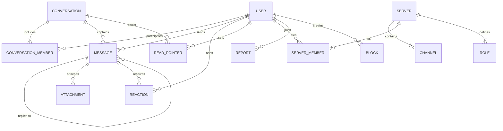

# Data Model — Holoraa (v2 draft)

- **Purpose:** Draft entity model for Holoraa. It guides future migrations and is not a schema yet.
- **Owner:** TODO(owner): Database & Backend Lead
- **Status:** Draft for owner review. Not approved. No table exists in v2 yet.
- **Last Updated:** 2026-10-25
- **Implemented vs Proposed:** Nothing is implemented. The first tables arrive through goose migrations at the milestone that needs them, with their tests.

---

## 1. Rules that apply now

- Schema changes go through goose migrations in `backend/db/migrations/`. Never change a shared database by hand.
- Migrations are forward-only SQL, reviewed like code, and tested from an empty database in CI.
- Queries are SQL in `backend/db/queries/`, compiled by sqlc into committed code.
- Identifiers are UUIDs. Timestamps are `timestamptz`.

## 2. Authentication-dependent fields

Credential storage (password hashes, session or token tables) is **not designed yet**. It depends on the owner-approved authentication design (AGENTS.md). Until that design exists, this draft contains no credential columns.

`TODO(owner): authentication design, including how credentials and sessions are stored.`

## 3. Draft entity relationships

Only messaging-related entities appear here. Calls, rooms, and stories are out of scope for this draft.

## 4. Draft entities

| Entity | Key fields (draft) | Notes |
|---|---|---|
| `users` | `id`, `username` (unique), `display_name`, `avatar_key`, `created_at` | Email and sign-in fields wait for the auth design. `avatar_key` points to object storage (provider `TODO(owner)`). |
| `conversations` | `id`, `kind` (`dm`, `group`, `channel`), `created_by`, `created_at` | `group` member cap is a proposal. Owner to confirm. |
| `conversation_members` | `conversation_id`, `user_id`, `joined_at` | Primary key on both ids. |
| `messages` | `id`, `conversation_id`, `sender_id`, `body`, `reply_to_id`, `created_at`, `edited_at` | Body length limit is `TODO(owner)`. Every external input has a size limit (AGENTS.md). |
| `attachments` | `id`, `message_id`, `kind`, `object_key`, `size_bytes`, `mime_type` | Upload flow and limits are Phase 3. |
| `reactions` | `message_id`, `user_id`, `emoji` | Unique on the three columns. |
| `read_pointers` | `conversation_id`, `user_id`, `last_read_message_id`, `updated_at` | One pointer per user per conversation. |
| `servers`, `channels`, `server_members`, `roles` | Standard relational fields | Phase 2. Permission model is `TODO(owner)`. |
| `reports`, `blocks` | `id`, `reporter_id`, `reported_id`, `reason`, `status`, `created_at` | Phase 4. Retention periods are `TODO(owner)` (see [PRIVACY_AND_COMPLIANCE.md](../security/PRIVACY_AND_COMPLIANCE.md)). |

## 5. Indexing intent (to confirm when each table is created)

- `messages (conversation_id, created_at DESC)` for conversation history with cursor pagination.
- `messages (channel_id, created_at DESC)` once channels exist.
- `reactions` unique on `(message_id, user_id, emoji)`.
- `read_pointers` primary key on `(conversation_id, user_id)`.

## 6. Open questions

- `TODO(owner)`: ordering of messages across concurrent senders (sequence versus timestamp).
- `TODO(owner)`: deletion behaviour for messages and accounts. See the privacy document, which gives two different grace periods that need reconciling.
- `TODO(owner)`: whether edit history is kept.
