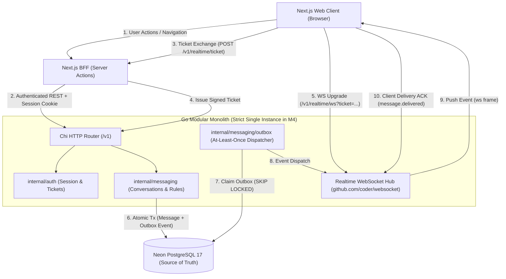
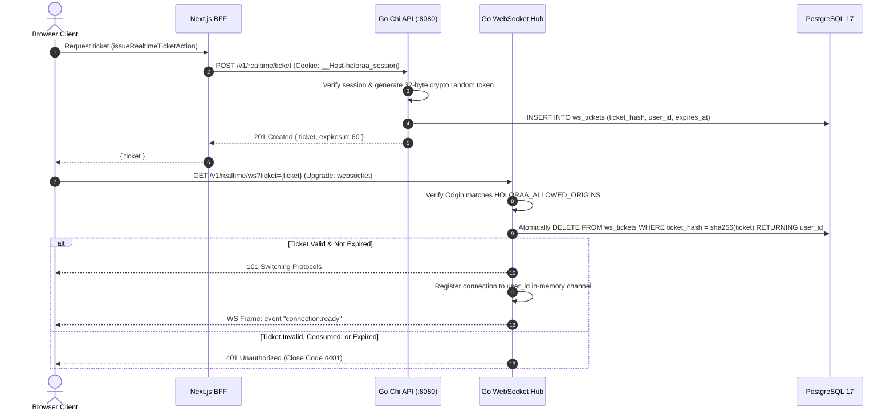

# High-Level Design (HLD) — Milestone 4: Direct Messaging & Real-Time Events

- **Milestone:** M4 — Direct Messaging & Real-Time Events
- **Document Version:** 1.1.0
- **Status:** Proposed for Owner Approval
- **Author:** Senior Backend Architect, Application Security Engineer, Full-Stack Engineer

---

## 1. System Topology & Architecture Overview

Holoraa v2 is architected as a modular Go backend monolith paired with a Next.js App Router Backend-for-Frontend (BFF). Milestone 4 adds a high-throughput, low-latency bidirectional real-time subsystem using Go WebSockets while maintaining PostgreSQL as the immutable, transactional source of truth.



---

## 2. Key Architectural Decisions (ADRs)

### 2.1 DEC-M4-01: WebSocket Engine Selection (`github.com/coder/websocket`)
- **Context:** The backend requires a robust WebSocket library that integrates cleanly with Go's standard library `context.Context`, avoids memory leaks, and provides strict RFC 6455 compliance.
- **Decision:** Adopt `github.com/coder/websocket` (formerly `nhooyr.io/websocket`).
- **Rationale:**
  - Modern, zero-dependency, idiomatic Go.
  - Native `context.Context` cancellation across read/write loops.
  - Zero goroutine leakage during abrupt socket disconnects.
  - Sub-10 KiB per-socket memory footprint, well within server memory budgets.

### 2.2 DEC-M4-02: Single-Use Cryptographic WebSocket Tickets
- **Context:** Browser WebSocket API (`new WebSocket(url)`) does not support custom HTTP request headers (such as `Authorization: Bearer ...`). Passing the long-lived `__Host-holoraa_session` cookie in WebSocket query parameters risks shoulder-surfing, proxy logging, and URL leakage.
- **Decision:** Authenticate WebSocket upgrades using short-lived (60s), single-use cryptographic tickets issued via an authenticated REST endpoint (`POST /v1/realtime/ticket`).
- **Security & Safety Specification:**
  1. **Token Generation:** Generated using `crypto/rand` (32 bytes hex-encoded = 256 bits of entropy).
  2. **Hash-Only Storage:** Stored in PostgreSQL `ws_tickets` solely as a SHA-256 digest (`ticket_hash = sha256(ticket)`). Plaintext tickets are never persisted.
  3. **Atomic Single-Use Consumption:**
     ```sql
     DELETE FROM ws_tickets
     WHERE ticket_hash = sha256($1) AND expires_at > now()
     RETURNING user_id;
     ```
     Because `DELETE ... RETURNING` executes atomically, concurrent or repeated upgrade attempts with the same ticket fail immediately with 401 Unauthorized.
  4. **Log Redaction:** The Go `accessLog` middleware strips query strings matching `ticket=*`, preventing ticket values from entering access logs or metrics.
  5. **URL Leakage Mitigation:**
     - Transport is strictly TLS encrypted (WSS).
     - Tickets have a strict 60-second TTL.
     - Single-use consumption invalidates the token milliseconds after issuance.
     - Browsers do not send WebSocket URLs in HTTP `Referer` headers to subsequent web navigations.

### 2.3 DEC-M4-03: Transactional Outbox Guarantees & Reconciliation
- **Context:** Decoupling message persistence from WebSocket fanout is necessary to prevent message loss during process crashes. However, distributed event delivery cannot promise "exactly-once" delivery across network boundaries.
- **Decision:** Implement a **Transactional Outbox with At-Least-Once Publication**.
- **Guarantees & Semantics:**
  - **Atomic Persistence:** The message row and the outbox event row commit within the **exact same PostgreSQL transaction**.
  - **At-Least-Once Publication:** The outbox worker dispatches events to active WebSocket connections. If the worker crashes after dispatching to a socket but before marking `delivered_at = now()` in the database, the event will be re-dispatched upon worker restart.
  - **Idempotent Client Consumption:** The client tracks received event UUIDs and message sequence numbers. Duplicate events received over WebSocket are discarded by the client without corrupting local state.
  - **Worker Crash Recovery:** On startup or failover, the outbox dispatcher scans for rows where `delivered_at IS NULL AND created_at < now() - interval '10 seconds'` and resumes processing.
  - **Poison-Event Isolation:** Outbox rows track `attempts`. If an event fails processing 5 times (e.g. malformed payload), it is marked `status = 'poison'`, logged with high severity, and moved to dead-letter observability, preventing queue stalling.
  - **Reconciliation Source of Truth:** PostgreSQL is the ultimate source of truth. If a WebSocket frame is dropped, client reconnection triggers a keyset reconciliation query (`GET /v1/conversations/{id}/messages?after={last_known_id}`) to reconcile missing history.

### 2.4 DEC-M4-04: Single-Instance WebSocket Limitations & Topology
- **Context:** Milestone 4 implements an in-memory connection registry (`internal/realtime/hub.go`). An in-memory hub is strictly process-local; it cannot broadcast events to users connected to other server nodes.
- **Decision:** M4 is explicitly scoped and deployed as a **single Go process instance**.
- **Guardrails & Constraints:**
  - Deployment configurations (Docker Compose, Render, fly.io) must set `replicas: 1`. Horizontal auto-scaling must be disabled.
  - **Zero Multi-Instance Claims:** The system does not claim or permit multi-instance execution in M4.
  - **Deployment Restart Behaviour:** During a new deployment or server restart:
    1. Active WebSocket connections receive a `1001 Going Away` close frame.
    2. Clients initiate reconnection using exponential backoff with full jitter (1s to 30s).
    3. Reconnecting clients request a fresh ticket, reconnect to the newly booted instance, and execute keyset catch-up.
  - **Prerequisites for Multi-Instance (M7):** Before running multiple instances, a distributed broker (Redis Pub/Sub or NATS) must be introduced to distribute WebSocket broadcasts across all node instances, along with distributed presence tracking.

### 2.5 DEC-M4-05: Delivery & Read Receipt Lifecycle
- **Context:** A successful server-side WebSocket write only proves that bytes entered the OS network socket buffer; it does **not** prove that the recipient's device received or rendered the message.
- **Decision:** Enforce clear, decoupled lifecycle states:
  1. **Sent (`sent`):** The message transaction has committed to PostgreSQL. Confirmed to the sender via server `message.ack`. (Single gray tick).
  2. **Delivered (`delivered`):** The recipient client application receives the frame and explicitly returns a `message.delivered` event containing `{ messageId, conversationId }`. The server persists `delivered_at = now()` and notifies the sender. (Double gray ticks).
  3. **Read (`read`):** The recipient satisfies the **Documented Visibility Policy**:
     - The conversation window is active and focused.
     - The browser tab is visible (`document.visibilityState === 'visible'`).
     - The message has been scrolled into the viewport for at least 500ms, or the user interacted with the thread.
     The recipient client sends `message.read` with the highest visible message ID. The server updates `conversation_members.last_read_message_id` and broadcasts `message.read` to the sender. (Double coral ticks).
  - **Watermark Monotonicity:** Read pointers are strictly monotonic. The server rejects or ignores incoming read receipts that point to a message sequence lower than the currently recorded watermark (`GREATEST(current_seq, new_seq)`).

### 2.6 DEC-M4-06: Message Request & Blocking Policy
- **Context:** Unrestricted DMs encourage spam and harassment. Following another user does not imply consent to receive unsolicited messages.
- **Decision:**
  - **Conversation States:** `conversations.status` supports `pending` (message request) and `accepted` (active conversation).
  - **Mutual Follow Bypass:** If User A and User B mutually follow each other, a new conversation initializes directly as `accepted`.
  - **Non-Mutual Message Requests:** If User A initiates a chat with User B without mutual follows, the conversation initializes as `pending`. User B must explicitly accept the request before regular messaging begins. User A cannot send additional messages while the request is pending.
  - **Rate Limiting:** Non-mutual users are rate-limited to initiating at most 5 new message requests per hour.
  - **Blocking Enforcement:**
    - Block records are stored in `blocks (blocker_id, blocked_id)`.
    - Blocking is bidirectional: if A blocks B, neither A nor B can initiate conversations, send messages, or receive presence/typing events.
    - If a conversation already exists, existing message history remains visible to both participants as a frozen archive, but neither participant can append new messages.
    - Blocking and unblocking operations are idempotent (`ON CONFLICT DO NOTHING`).

---

## 3. End-to-End Sequence Workflows

### 3.1 WebSocket Handshake & Ticket Exchange



---

### 3.2 Real-Time Message Transmission & Delivery Lifecycle

```mermaid
sequenceDiagram
    autonumber
    actor Alice as Alice (Sender)
    participant AliceWS as Alice WebSocket
    participant API as Go API / Hub
    participant DB as PostgreSQL 17
    participant BobWS as Bob WebSocket
    actor Bob as Bob (Recipient)

    Alice->>Alice: Enqueue message bubble (optimistic: pending clock icon)
    Alice->>AliceWS: WS Frame: event "message.send" { convId, clientMsgId, content }
    AliceWS->>API: Validate payload (UTF-8, 1-4000 chars, no control codes)

    rect rgb(20, 20, 30)
        Note over API,DB: Single Atomic PostgreSQL Transaction
        API->>DB: Verify membership, status = 'accepted', and zero blocks
        API->>DB: INSERT INTO messages (id, conv_id, sender_id, client_msg_id, content)
        API->>DB: INSERT INTO outbox_events (event_type, payload, target_user_ids)
        API->>DB: UPDATE conversations SET updated_at = now()
    end

    API-->>AliceWS: WS Frame: event "message.ack" { clientMsgId, messageId, sequenceNum }
    Alice->>Alice: Transition bubble to "sent" (single gray tick)

    Note over API,BobWS: At-Least-Once Outbox Dispatch
    API->>BobWS: WS Frame: event "message.created" { message }
    BobWS->>BobWS: Deduplicate by message.id & render in active thread
    BobWS->>API: WS Frame: event "message.delivered" { messageId, conversationId }

    API->>DB: UPDATE messages SET delivered_at = now() WHERE id = $messageId
    API->>AliceWS: WS Frame: event "message.status" { messageId, status: "delivered" }
    Alice->>Alice: Transition bubble to "delivered" (double gray ticks)

    Note over Bob,BobWS: Visibility Policy Satisfied (Focused for >= 500ms)
    Bob->>BobWS: Reads message in viewport
    BobWS->>API: WS Frame: event "message.read" { conversationId, messageId }
    API->>DB: UPDATE conversation_members SET last_read_message_id = $messageId
    API->>AliceWS: WS Frame: event "message.status" { messageId, status: "read" }
    Alice->>Alice: Transition bubble to "read" (double coral ticks)
```



---

## 4. Controlled Performance Acceptance Criteria

| Metric | Controlled Test Target (p50) | Controlled Test Target (p95) | Controlled Test Target (p99) | Test Harness / Methodology |
|---|---|---|---|---|
| **Database Transaction Commit** | ≤ 15 ms | ≤ 35 ms | ≤ 80 ms | Go benchmark running concurrent message inserts with pgxpool. |
| **Outbox Dispatch Latency** | ≤ 20 ms | ≤ 50 ms | ≤ 120 ms | Measured from DB commit timestamp to WebSocket write frame timestamp. |
| **End-to-End Delivery ACK** | ≤ 60 ms | ≤ 140 ms | ≤ 300 ms | Two simulated clients on loopback network measuring send-to-delivered roundtrip. |
| **Keyset Cursor Pagination (50 msgs)**| ≤ 8 ms | ≤ 20 ms | ≤ 50 ms | Keyset SQL execution against a populated conversation table (10,000 rows). |
| **Throughput Capacity** | 50 msgs/sec | 100 msgs/sec | 150 msgs/sec peak | Sustained over 10 minutes across 500 concurrent connections on single instance. |

*Real-world observations will be separately collected via client telemetry and Prometheus histograms to record WAN mobile network conditions.*
