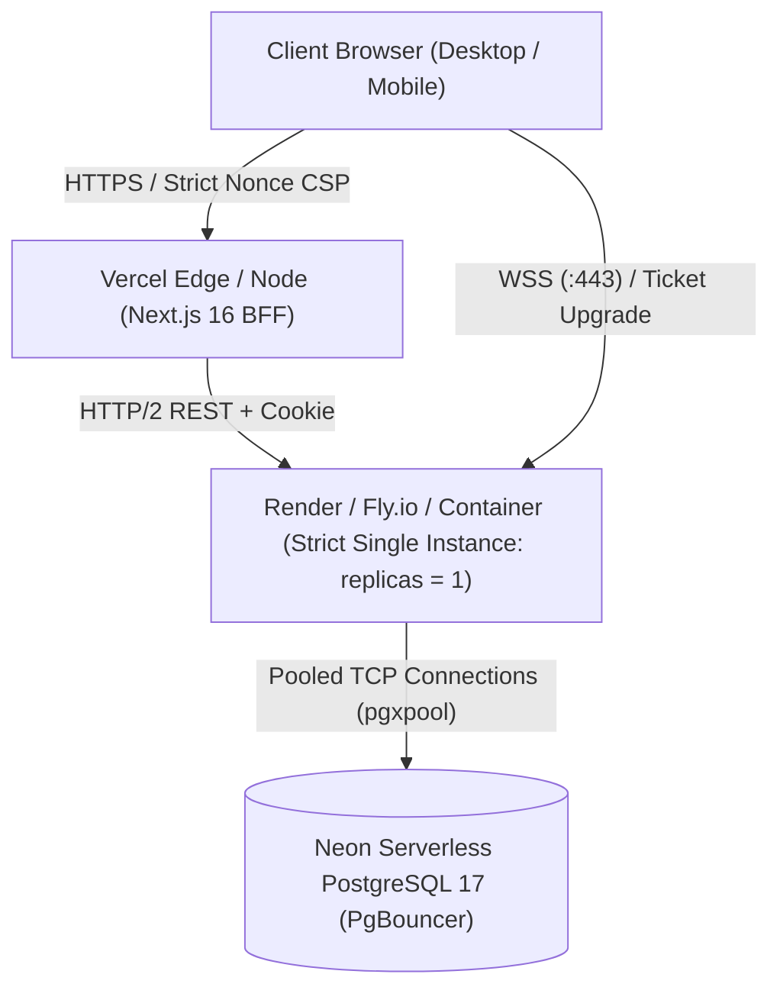

# Operations Runbook — Milestone 4: Direct Messaging & Real-Time Events

- **Milestone:** M4 — Direct Messaging & Real-Time Events
- **Document Version:** 1.1.0
- **Status:** Proposed for Owner Approval
- **Author:** Senior Backend Architect, Site Reliability Engineer, Application Security Engineer

---

## 1. Supported Deployment Topology & Single-Instance Mandate

### 1.1 Single-Instance Monolith Specification
During **Milestone 4**, the Go backend operates strictly as a **single-instance monolith**.



### 1.2 Multi-Instance Guardrails
- **The In-Memory Hub is Process-Local:** The WebSocket connection registry (`internal/realtime/hub.go`) stores connection pointers in local RAM. If multiple instances were deployed behind a round-robin load balancer without an external broker, User A connected to Instance 1 would never receive messages from User B connected to Instance 2.
- **Enforcement Guardrail:** Infrastructure definitions (Docker Compose, Render, fly.io, Kubernetes) must strictly set:
  ```yaml
  replicas: 1
  autoscaling:
    enabled: false
  ```
- **Mandatory Requirements Before Multi-Instance (M7):**
  1. Distributed Pub/Sub broker (e.g. Redis Pub/Sub, NATS, or Dragonfly) to broadcast socket frames across instances.
  2. Distributed presence engine to track which node holds a user's active sockets.
  3. Distributed consumer group coordination for outbox processing.

---

## 2. Deployment & Restart Playbook

### 2.1 Behavior During Deployment / Restart
When a new container version is deployed or the process restarts:
1. **Graceful Draining:** The server enters graceful shutdown (`srv.Shutdown(ctx)` with a 10s deadline).
2. **WebSocket Notification:** The hub broadcasts a WebSocket close frame (`code 1001 Going Away`) to all connected clients.
3. **Client Reconnection with Jitter:** Clients immediately handle the close frame by starting an exponential backoff loop with full jitter:
   $$\text{backoff} = \min(1000 \times 2^{\text{attempts}} + \text{rand}(500), 30000) \text{ ms}$$
   This prevents a "thundering herd" reconnection storm against the newly booted backend instance.
4. **Ticket Re-issuance & Keyset Catch-Up:** Reconnected clients request a fresh ticket via `POST /v1/realtime/ticket` and execute `GET /v1/conversations/{id}/messages?after={last_known_id}` to reconcile any messages committed during the restart window.

---

## 3. Transactional Outbox Operations & Recovery

### 3.1 At-Least-Once Delivery & Worker Crash Recovery
- **Commit Phase:** The API server commits the message row and the outbox event row in the **same PostgreSQL transaction**.
- **Dispatch Phase:** The background outbox worker claims batches of pending events using:
  ```sql
  SELECT * FROM outbox_events WHERE status = 'pending' ORDER BY id ASC LIMIT 100 FOR UPDATE SKIP LOCKED
  ```
- **Crash Recovery:** If the Go process crashes mid-dispatch:
  1. Uncommitted dispatch operations leave outbox rows in `status = 'processing'`.
  2. Upon process reboot, the outbox worker reclaims orphaned rows where `status = 'processing' AND created_at < now() - interval '15 seconds'`.
  3. The events are re-dispatched to active WebSockets.
  4. Recipient clients deduplicate received frames by `message.id`.
- **Database as Source of Truth:** If a WebSocket delivery fails completely, the recipient's next client navigation or reconnection recovers the message from PostgreSQL via keyset pagination.

### 3.2 Poison-Event Handling & Dead-Letter Isolation
- Each outbox event tracks `attempts smallint`.
- If an event encounters an unrecoverable failure (e.g. malformed JSON payload) for **5 consecutive attempts**:
  1. The worker transitions the row to `status = 'poison'`.
  2. The failure is recorded in `outbox_events.error_message`.
  3. A high-priority Sentry / log alert is triggered: `event_poisoned`.
  4. Subsequent pending events continue processing without queue stalling.

### 3.3 Outbox Retention & Cleanup Job
A recurring maintenance task (or nightly cron) purges delivered outbox events:
```sql
DELETE FROM outbox_events WHERE status = 'delivered' AND delivered_at < now() - interval '7 days';
```

---

## 4. Database Connection Management (Neon & PgBouncer)

### 4.1 Connection Limits & Pool Sizing
Because Neon uses PgBouncer in transaction pooling mode:
- **Max Connections (`max_conns`):** 25.
- **Min Connections (`min_conns`):** 5.
- **Max Conn Idle Time:** 5 minutes.
- **Statement Timeout:** Default 5 seconds (`statement_timeout = '5s'`) to kill runaway queries.

### 4.2 Resilient Outbox Polling Fallback
- Neon's serverless architecture may terminate idle socket connections across compute sleep cycles.
- **Dual-Mode Dispatcher:** The outbox dispatcher pairs `LISTEN` on a dedicated session connection with a **250ms batch polling fallback** (`SKIP LOCKED`). Even if serverless connections cycle, outbox delivery latency remains bounded.

---

## 5. Observability, Telemetry & Logging

### 5.1 Strict Redaction Policy (`log/slog`)
- **Forbidden in Logs:** Message text, sender/recipient emails, session tokens, and WebSocket tickets must **never** be logged.
- **Sanitized Log Sample:**
  ```json
  {
    "time": "2026-11-08T20:30:15.123Z",
    "level": "INFO",
    "msg": "message committed",
    "conversation_id": "7f001...",
    "sender_id": "3b12...",
    "sequence_num": 104,
    "duration_ms": 12,
    "request_id": "req-98f..."
  }
  ```

### 5.2 Prometheus Metrics
- `holoraa_ws_active_connections`: Current active WebSocket sockets.
- `holoraa_ws_connection_duration_seconds`: Socket lifespan histogram.
- `holoraa_messages_committed_total`: Total committed messages counter.
- `holoraa_outbox_queue_depth`: Gauge of pending outbox rows (`status = 'pending'`).
- `holoraa_outbox_poison_total`: Counter of poisoned outbox events (alerts if > 0).
- `holoraa_commit_duration_seconds`: Histogram of message insert transaction latencies.
- `holoraa_delivery_ack_latency_seconds`: Histogram of roundtrip send-to-delivered times.
